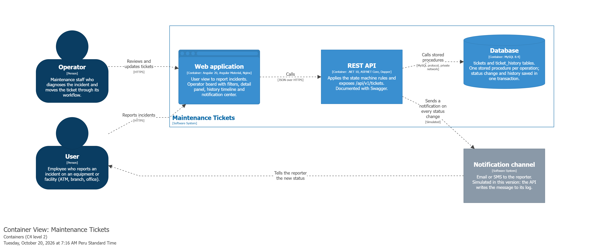

# Maintenance Tickets

Maintenance ticket management system with a state machine workflow and full audit history. A **user** reports an incident (an ATM out of service, a water leak) and an **operator** moves the ticket through a validated workflow; every change is saved in the ticket history.

## Live demo

| | URL |
|---|---|
| Web app | https://frontend-production-ef2d0.up.railway.app |
| API (Swagger) | https://api-production-c373.up.railway.app/swagger |

Use the **View as** switch in the header to change between the **User** view (report an incident) and the **Operator** view (ticket board).

## Requirements coverage

| Code | Requirement | How it is solved |
|---|---|---|
| R2.1 | Ticket form and status board | Validated report form (`/report`) and operator board (`/board`) with one column per status and a detail panel. |
| R2.2 | Valid transitions | `Pending → InProgress → Resolved → Closed`; `Pending`, `InProgress` and `Resolved` can also go to `Cancelled`. The rules live in the domain layer (`TicketStateMachine`, `Ticket.ChangeStatus`) and the API returns each ticket's `allowedTransitions`, so the UI only shows valid actions. |
| R2.3 | Invalid transitions blocked | An invalid transition returns `409 Conflict` and nothing is saved. Resolving without a diagnosis or cancelling without a reason returns `400 Bad Request`. Errors use the ProblemDetails format, never a generic `500`. |
| R2.4 | 1–N integrity | `ticket_history.ticket_id` is a foreign key to `tickets` with `ON DELETE RESTRICT`; `CHECK` constraints only accept valid statuses. |
| R2.5 | Stored procedures | `sp_change_ticket_status` updates the status and inserts the history row in one transaction, with optimistic concurrency (a concurrent change returns `409`). Every API operation uses a stored procedure: [`database/02_stored_procedures.sql`](database/02_stored_procedures.sql). |
| R2.6 | Persisted history | One `ticket_history` row per creation and status change (previous and new status, comment, author, date), shown as a timeline in the detail panel. |
| R2.7 | Separation of responsibilities | Layers per bounded context in both apps (domain, application, infrastructure, interfaces/presentation); no business logic in the controller; secrets in environment variables. |
| R2.8 | Sequence analysis | [Create ticket](docs/diagrams/sequence-create-ticket.png) · [Change ticket status](docs/diagrams/sequence-change-ticket-status.png) |
| R2.9 | Data structure | [ERD](docs/diagrams/erd.png): `tickets` (1) — (N) `ticket_history` |
| R2.10 | Deployed app | Railway (see [Live demo](#live-demo)) |
| R2.11 | Public source code | [`frontend/`](frontend), [`backend/`](backend) and [`database/`](database) in this repository |
| R2.12 | Documentation and English | This README, Swagger documentation, and code and commits in English |
| Bonus | Filters and notification | Board filters by status and creation date. Simulated notification to the reporter on every status change (written to the API log and shown in the header bell). Ticket assignment is not implemented. |

Other deliverables: [UI mockup (Figma)](https://www.figma.com/design/yfST2frwJIU2kBTWH70BxW/maintenance-tickets-mockup) · [AI prompts](PROMPTS.md)

## Architecture



The Angular app calls the REST API, and the API calls the MySQL stored procedures through Railway's private network. More diagrams: [system context (C4)](docs/diagrams/c4-context.png) · [domain classes](docs/diagrams/class-domain.png) · [backend layers](docs/diagrams/class-backend-layers.png) · [frontend classes](docs/diagrams/class-frontend.png).

```
maintenance-tickets/
├── backend/      .NET 10 Web API: Maintenance bounded context (Domain, Application, Infrastructure, Interfaces) + Shared
├── frontend/     Angular 20 app: maintenance (domain, infrastructure, application, presentation) + shared
├── database/     Schema, stored procedures and seed data (run in this order)
└── docs/         Diagrams: C4 (Structurizr DSL), class and sequence (PlantUML), ERD, all exported as PNG
```

## Tech stack

| Layer | Technology | Why |
|---|---|---|
| Frontend | Angular 20, Angular Material | Standalone components and signals keep the state simple; Material gives accessible form fields and feedback components. |
| Backend | .NET 10 (LTS), ASP.NET Core | Long-term support, strong typing and a clear way to separate layers. |
| Data access | Dapper | The business operations must run as stored procedures; Dapper calls them directly without the change tracking of a full ORM. |
| Database | MySQL 8.4 | Foreign keys, check constraints, transactions and stored procedures. |
| Deployment | Railway (Docker) | Deploys the API, the frontend and MySQL from one repository, with a private network between them. |

## Run locally

**Prerequisites:** [Docker Desktop](https://www.docker.com/products/docker-desktop/), [.NET 10 SDK](https://dotnet.microsoft.com/download/dotnet/10.0) and [Node.js 22](https://nodejs.org/).

**1. Database.** Copy the environment template and set your own passwords (letters and numbers only):

```bash
cp .env.example .env
docker compose up -d
```

MySQL runs on port **3307**. On the first start, Docker runs the scripts in `database/` and creates the schema, stored procedures and sample data. To start from scratch, run `docker compose down -v` and then `docker compose up -d` again.

**2. Backend.** The connection string is stored in user secrets, never in the repository. Use the `MYSQL_PASSWORD` value from your `.env`:

```bash
cd backend/MaintenanceTickets.API
dotnet user-secrets set "ConnectionStrings:DefaultConnection" "Server=127.0.0.1;Port=3307;Database=maintenance_tickets;User ID=app_user;Password=YOUR_MYSQL_PASSWORD;"
dotnet run --launch-profile http
```

The API runs on http://localhost:5146 (Swagger at http://localhost:5146/swagger).

**3. Frontend.**

```bash
cd frontend
npm ci
npm start
```

Open http://localhost:4200. In development the app calls the API at `http://localhost:5146/api/v1`.

## Notes

- **Roles are simulated** with the header switch; authentication is out of scope for this proof of concept.
- **Deployment:** the `api` and `frontend` services are built from their Dockerfiles. Railway variables hold the connection string (a dedicated database user, not `root`) and the allowed CORS origin.
- **Git workflow:** GitFlow (`feature/*` → `develop` → `release/*` → `main`, tag `v1.0.0`) with Conventional Commits.
